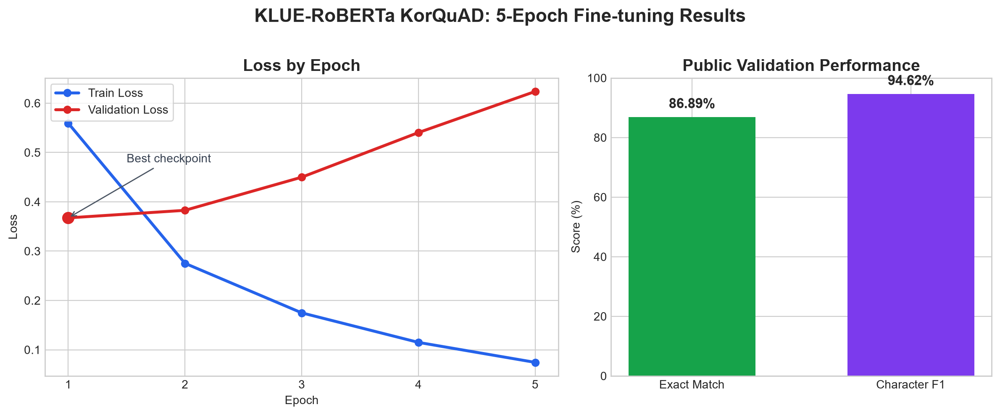

# 과제 3. KLUE-RoBERTa 기반 한국어 문서 질의응답

## 프로젝트 개요

이 프로젝트는 한국어 문단과 질문을 입력받아 문단 안에서 답변 구절을 찾아내는 **추출형 질의응답(Extractive Question Answering)** 시스템이다. 

Hugging Face의 사전학습 모델을 KorQuAD 데이터셋으로 파인튜닝하고, 독립된 공개 검증 세트에서 성능을 평가했다. 

## 1. 사용한 모델과 데이터셋 소개

### 모델: `klue/roberta-base`

`klue/roberta-base`는 한국어 언어 이해를 위해 사전학습된 **encoder-only Transformer** 모델이다. 
RoBERTa 구조를 기반으로 하며, 프로젝트에서는 `AutoModelForQuestionAnswering`을 사용해 문단에서 답의 **시작 토큰**과 **끝 토큰**을 예측하도록 구성했다. 
>답변을 새로 생성하는 모델이 아니라 입력 문단에 이미 있는 구절을 답으로 추출한다.

### 데이터셋: `KorQuAD/squad_kor_v1`

KorQuAD는 한국어 위키백과 문단을 바탕으로 만든 추출형 질의응답 데이터셋이다. 

각 예제는 문단(`context`), 질문(`question`), 정답 문자열과 정답 시작 문자 위치(`answers.text`, `answers.answer_start`)로 이루어진다. 

원본 학습 세트는 60,407개, 공개 검증 세트는 5,774개 문답으로 구성된다.

과적합을 점검하기 위해 원본 학습 세트를 기사 제목(`title`) 기준으로 분리했다. 같은 기사에서 나온 문단이 학습과 내부 검증에 동시에 들어가지 않도록 하여 데이터 누수를 줄였다.

| 구분 | 문답 수 | 용도 |
| --- | ---: | --- |
| 내부 학습 | 55,130 | 모델 파인튜닝 |
| 내부 검증 | 5,277 | epoch별 검증 및 최적 체크포인트 선택 |
| 공개 검증 | 5,774 | 최종 성능 평가 |

## 2. Tokenizer를 이용한 데이터 전처리

`AutoTokenizer`의 Fast tokenizer로 질문과 문단을 한 쌍으로 토큰화했다. 질문은 유지하고 문단만 길이 제한에 맞춰 자르기 위해 `truncation="only_second"`를 적용했다. 최대 입력 길이는 **384 토큰**, 긴 문단을 나눌 때 인접 창 사이의 중복 길이는 **128 토큰**으로 설정했다. 이 방식은 긴 문단의 답변이 잘리는 문제를 줄인다.
>처음 512토큰을 실행했을 때 GPU 메모리 사용량과 학습시간이 너무 크게 증가해서 512 - 128 인 384 토큰으로 진행하였다.

학습용 전처리에서는 `offset_mapping`과 `sequence_ids`를 사용해 정답의 문자 단위 위치를 토큰 단위의 시작·끝 위치로 변환했다. 정답이 현재 토큰 창에 포함되지 않는 경우에는 CLS 토큰 위치를 정답으로 지정했다. 전체 학습 문답 55,130개는 긴 문단 분할 후 **63,503개 토큰 창**으로 늘어났다. 내부 검증 문답 5,277개도 **5,896개 토큰 창**으로 변환됐다.

평가와 예측에서는 토큰 위치를 다시 원문 문자 위치로 변환하여 최종 답변 문자열을 복원한다. 또한 KLUE-RoBERTa에 맞지 않는 `token_type_ids`는 입력에서 제외했다.

## 3. 사전학습 모델 Fine-tuning

사전학습된 `klue/roberta-base`에 질의응답 헤드를 결합한 뒤, KorQuAD의 정답 시작·끝 토큰 위치를 목표값으로 파인튜닝했다. `Trainer`를 이용해 학습했으며, Validation Loss가 가장 낮은 모델을 최종 모델로 선택했다.

| 설정 | 값 |
| --- | --- |
| 학습 epoch | 5 |
| 학습률 | 2e-5 |
| 장치 | NVIDIA GPU(CUDA) |
| 학습 배치 크기 | 8 |
| Gradient accumulation | 2 |
| 유효 배치 크기 | 16 |
| 가중치 감쇠 | 0.01 |
| 평가·저장 주기 | 매 epoch |
| 최적 모델 기준 | Validation Loss 최소 |

전체 학습은 19,845 step으로 진행됐고, 가장 낮은 Validation Loss를 기록한 **1 epoch, step 3,969**의 체크포인트를 최종 모델로 채택했다. 

## 4. 학습 과정 및 성능 평가

전체 데이터 학습은 약 **1시간 5분 53초** 동안 진행됐다. 

최종 Train Loss는 0.2397이었으며, Validation Loss는 1 epoch에서 가장 낮았다. 

이후 Train Loss는 계속 감소했지만 Validation Loss는 꾸준히 상승해, 1 epoch 이후에는 과적합이 진행되는 경향을 확인할 수 있다.

| Epoch | Train Loss | Validation Loss |
| ---: | ---: | ---: |
| 1 | 0.5594 | **0.3674** |
| 2 | 0.2752 | 0.3827 |
| 3 | 0.1748 | 0.4499 |
| 4 | 0.1149 | 0.5404 |
| 5 | 0.0744 | 0.6237 |

>  그림 1. Train Loss와 Validation Loss의 epoch별 변화, 그리고 공개 검증 성능. Validation Loss가 가장 낮은 epoch 1의 체크포인트를 최종 모델로 선택했다.

최종 평가는 학습에 사용하지 않은 공개 검증 문답 5,774개로 수행했다. **Exact Match**는 정답과 예측이 정규화 후 정확히 일치한 비율이고, 문자 단위 F1은 정답과 예측 문자열의 겹침 정도를 나타낸다.

| 평가 지표 | 결과 |
| --- | ---: |
| Exact Match | **86.89%** |
| 문자 단위 F1 | **94.62%** |

문단 길이별 결과에서는 2,000자 초과 문단의 Exact Match가 68.09%로, 짧은 문단보다 낮았다. 

긴 문단일수록 답이 들어 있는 토큰 창을 정확히 찾고 시작·끝 위치를 예측하기 어려워지는 것으로 해석할 수 있었다.

| 문단 길이 | 문답 수 | Exact Match | 문자 단위 F1 |
| --- | ---: | ---: | ---: |
| 500자 이하 | 3,483 | 86.91% | 94.57% |
| 501~1,000자 | 2,058 | 87.56% | 95.20% |
| 1,001~2,000자 | 186 | 83.87% | 91.58% |
| 2,000자 초과 | 47 | 68.09% | 85.94% |

## 5. 새로운 문장을 직접 입력하여 예측

학습에 사용하지 않은 문단을 직접 작성해 예측을 확인했다.

| 항목 | 내용 |
| --- | --- |
| 문단 | 도서관은 평일 오전 9시부터 오후 8시까지 운영한다. 토요일에는 오전 10시부터 오후 5시까지 운영하며, 일요일과 공휴일에는 휴관한다. |
| 질문 | 토요일 도서관 운영 시간은 언제인가요? |
| 모델 예측 | **오전 10시부터 오후 5시** |

질문의 핵심 조건인 ‘토요일’을 문단의 해당 시간 정보와 연결해 올바른 시간 범위를 추출했다. 

하지만 원문에 있는 조사 ‘까지’는 제외되어, 의미는 맞지만 문자열이 완전히 일치하지 않을 수 있는 추출형 질의응답의 특성도 확인할 수 있었다. 

## 6. 모델의 문제점 및 개선 방법 분석

| 문제점 | 근거 및 영향 | 개선 방법 |
| --- | --- | --- |
| 긴 문단에서 성능 하락 | 2,000자 초과 문단의 Exact Match가 68.09%로 전체 Exact Match보다 낮음 | 문단 검색(retrieval)을 먼저 수행해 관련 문단을 좁힌 뒤 답변을 추출하거나, 최대 길이와 stride를 비교 실험 |
| 1 epoch 이후 Validation Loss 상승 | Validation Loss가 0.3674 → 0.3827 → 0.4499 → 0.5404 → 0.6237로 증가 | Early stopping을 적용하고 epoch, 학습률, warmup 비율을 탐색 |
| 답변 불가 질문 처리 불가 | KorQuAD v1은 문단 안에 답이 있는 추출형 데이터셋 | 답변 불가(no-answer) 예제가 있는 데이터로 추가 학습하고, 답변 거절 임계값을 검증 |
| 유사하지만 완전히 일치하지 않는 답 | 예: ‘제89조’를 ‘89조’로 예측하면 의미는 가깝지만 Exact Match에서는 오답 | 정답 표기 정규화 규칙을 보완하고, Exact Match와 F1을 함께 해석 |

## 실행 결과 파일

전체 학습 결과는 다음 폴더에 저장되어 있다.

- 학습 요약
- 최종 평가 지표
- 학습 이력
- 오류 사례
- 새 문장 예측 결과
