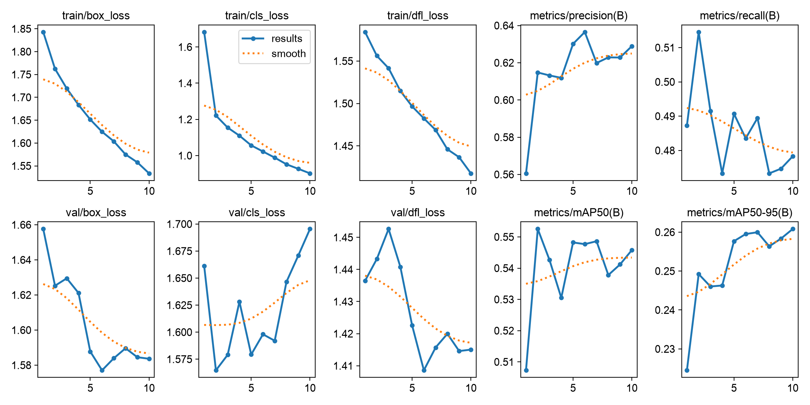
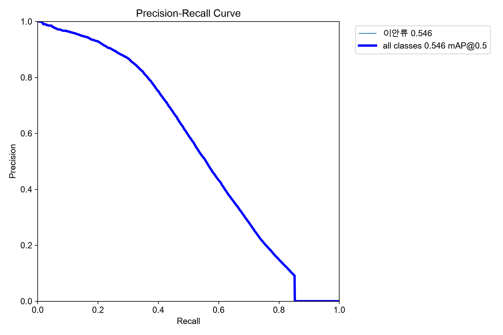
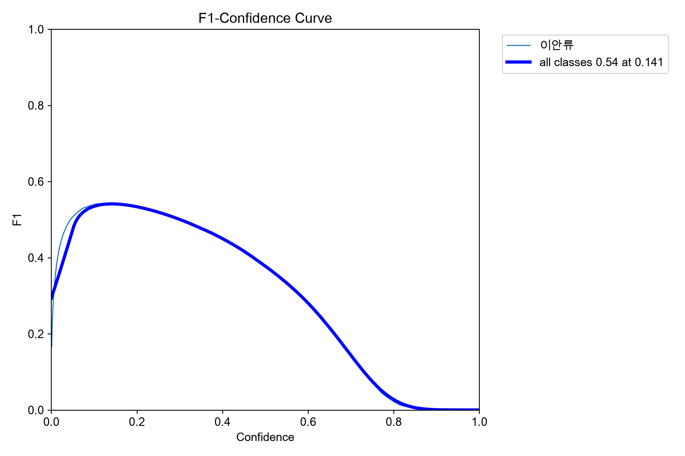
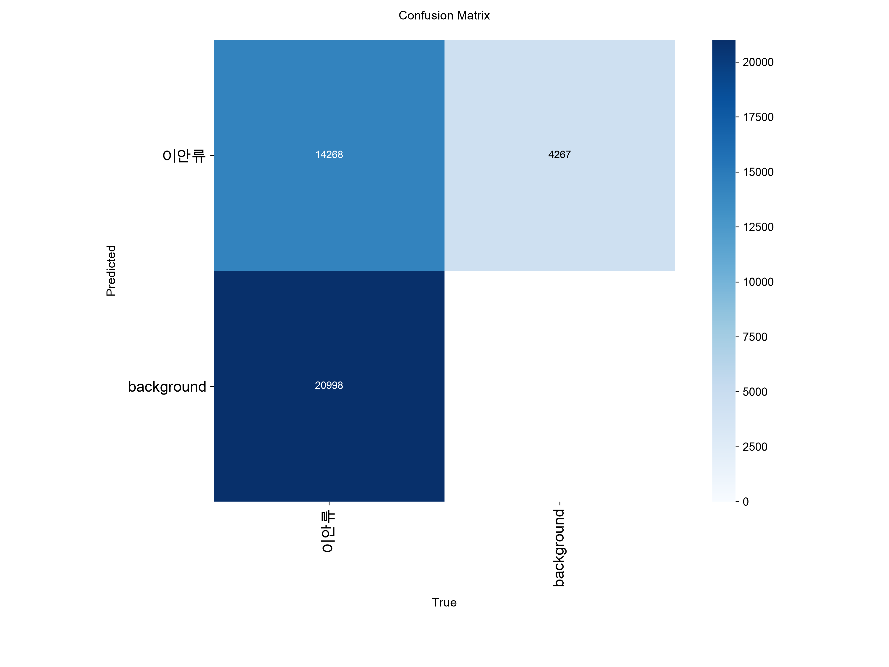

# 이안류 CCTV YOLO Detect 학습 결과

2026-10-11에 저장된 로컬 실행 기록을 정리했다. 이번 저장소 정리 과정에서 재학습하지 않았다.

## 데이터와 학습 설정

| 항목 | 값 |
|---|---|
| 전체 Train 이미지 / JSON | 각각 248,139개 |
| 전체 Validation 이미지 / JSON | 각각 31,012개 |
| 변환된 양성 이미지 | Train 200,255장 / Validation 24,975장 |
| 배경 이미지 | Train 47,884장 / Validation 6,037장 |
| 변환 시 누락 이미지 | 0장 |
| 클래스 | `0: 이안류` |
| 모델 | 사전학습 YOLO11n |
| 학습 장치 | NVIDIA GeForce RTX 2080 SUPER, CUDA 11.8 |
| epoch / 이미지 크기 / batch | 10 / 640 / 4 |
| 학습 비율 | `fraction=0.25`, 62,035장 |
| 검증 데이터 | 전체 31,012장 |
| random seed | 2026 |
| 저장된 실행 폴더 | `runs/detect/ripcurrent_yolo11n-4` |

원본에서 제공한 Train / Validation 분할을 유지했다. 두 분할 간 동일 이미지 파일명은 없었지만, 동일 촬영 영상의 인접 프레임까지 독립적인지는 추가 확인이 필요하다.

## best.pt 재평가

노트북의 별도 `best_model.val()` 실행에 저장된 값이다.

| 지표 | 값 |
|---|---:|
| Precision | 0.6287 |
| Recall | 0.4779 |
| mAP50 | 0.5457 |
| mAP50–95 | 0.2609 |

마지막 epoch의 Train Loss는 box **1.53361**, cls **0.90163**, dfl **1.41760**이다. 전체 epoch 기록은 [training_history.csv](training_history.csv)에 보존했다. 재평가 지표와 CSV의 epoch별 지표는 실행 조건 차이로 소폭 다를 수 있다.

## 추론 확인

`best.pt`로 검증 이미지 `HD_GLORY_20190607_090248.jpg`를 추론했다. 이안류 1개를 탐지했고, 신뢰도는 **0.742946**, 박스 좌표는 약 `[1177.0, 424.2, 1452.1, 628.5]`였다. 로컬 저장 이미지에서 박스와 `이안류 0.74` 표시를 확인했다.

현재 기록은 검증 이미지 추론이며, 별도로 확보한 새 CCTV 이미지나 영상에 대한 실행 기록은 없다. 실제 CCTV 이미지와 학습 가중치는 저장소에 포함하지 않는다.

## 한계와 주의사항

- 현재 설치 버전의 `fraction=0.25`는 정렬된 이미지 목록의 앞 25%를 사용한다. 무작위·장소별 균형 추출이 아니므로 촬영 장소나 날짜가 편향될 수 있다.
- 일부 중복 라벨은 Ultralytics가 로딩 중 제거했다. Validation 객체 수는 원본 변환 보고의 35,312개에서 로딩 후 35,266개로 줄었다.
- 학습 Loss 감소만으로 일반화 성능 향상을 단정할 수 없다. Recall과 mAP를 함께 확인하고 독립적인 새 CCTV 데이터로 평가해야 한다.
- 이 결과는 과제용 실험이며 실제 안전 판단을 대체하지 않는다.
